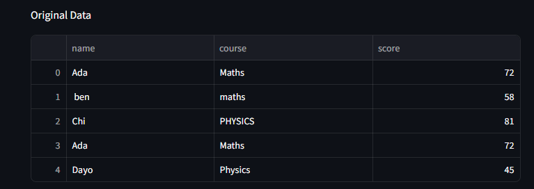
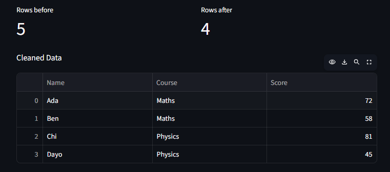

# CSV to Excel Report Converter

A tool that turns messy CSV files into clean, styled Excel reports.

**Live demo:** [Try the app here](https://csv-to-excel-report-djnfxu9pdtdlnhz4qembkl.streamlit.app/)

## Before and After

### Before: a messy CSV file



### After: a cleaned Excel report



## Features

- Trims extra spaces
- Fixes inconsistent capitalization
- Removes duplicate rows
- Removes empty rows
- Produces a styled Excel report with a green header, automatic column widths, a frozen header row and an Average row for numeric columns
- Shows before and after row counts

## Run It Locally

1. Install the requirements:

```
pip install -r requirements.txt
```

2. Start the app:

```
python -m streamlit run app_report.py
```

## Troubleshooting

If the tables or row counts fail to load in the live app, a browser extension such as an ad blocker may be blocking them. Disable your extensions for the site, or open the app in an incognito window.
